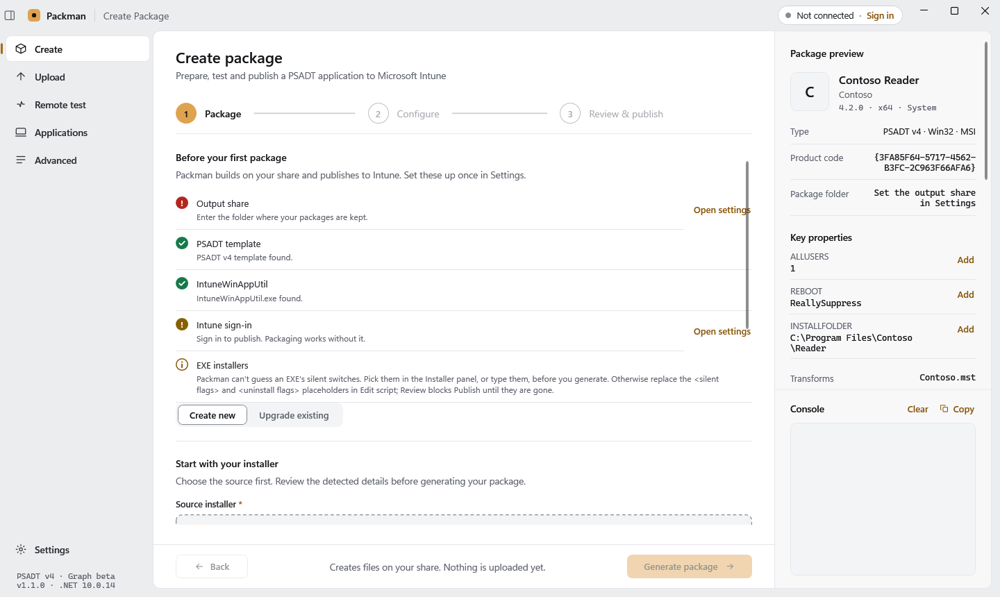
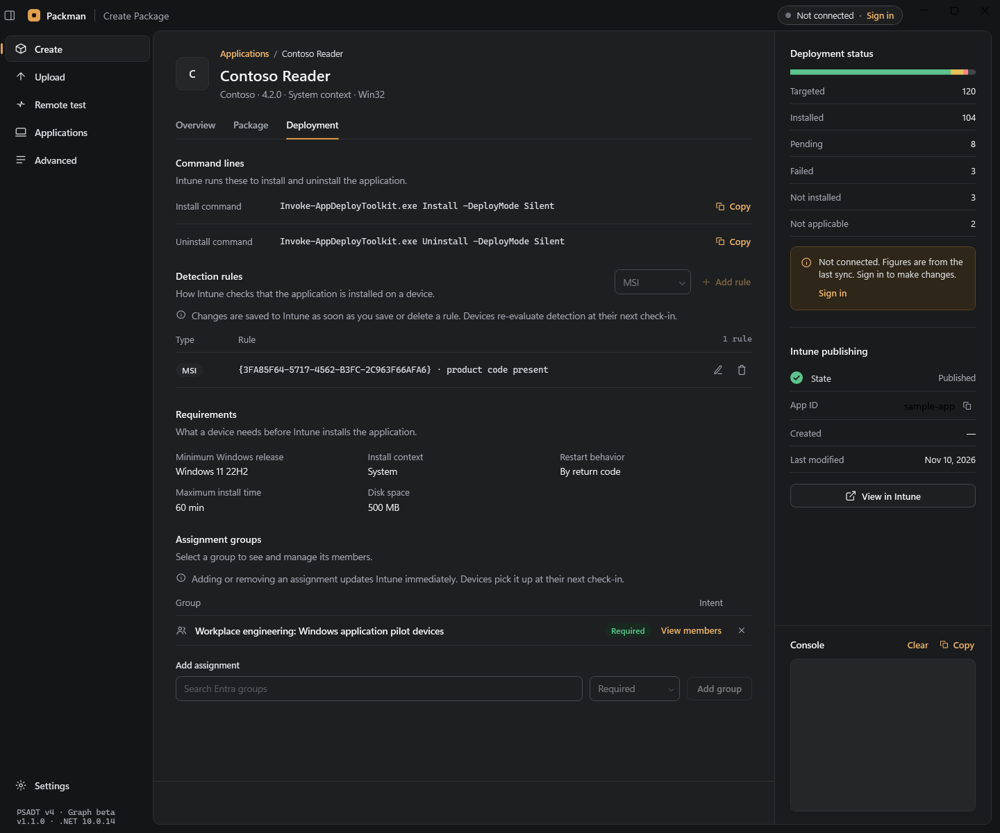

# PACKMAN

A Windows desktop app for packaging Win32 applications with the **PowerShell App
Deployment Toolkit (PSADT) v4** and publishing them to **Microsoft Intune**.

Point Packman at an installer (MSI or EXE). It reads the file's metadata, wraps it in a PSADT v4
package on your share, lets you edit the deploy script, test the install on a real machine, builds
the `.intunewin`, and publishes it to your tenant over Microsoft Graph — detection rules,
requirements, return codes, group assignment, code signing and supersedence included.

**Community edition · Apache 2.0 · Windows / .NET 10**

In a hurry? [HOWTO.md](HOWTO.md) is the five-step quick start, and the [manual](docs/MANUAL.md)
explains every screen. See [Contributing](CONTRIBUTING.md), [the Community / Pro roadmap](ROADMAP.md)
and [private security reporting](SECURITY.md).
Existing packaging and Intune workflows stay in the free community edition. Key Vault authentication,
WDAC catalog generation and GitLab pipelines are planned commercial integrations.



<details>
<summary>Application deployment in the dark theme</summary>



</details>

These are native Windows CI renders with sample data; they do not show a live tenant deployment.

---

## Contents

- [Features](#features)
- [Requirements](#requirements)
- [Get started](#get-started)
- [Documentation](#documentation)
- [Limits](#limits)
- [License](#license)

---

## Features

Each area links to the part of the [manual](docs/MANUAL.md) that explains it.

### Packaging

- Create a PSADT v4 package from an **MSI** or **EXE** — browse or drag and drop the file. Name,
  manufacturer, version, icon and (for an MSI) the product code are read straight out of the
  installer, and every field stays editable. See [Creating a package](docs/MANUAL.md#creating-a-package).
- Architecture (x64 / x86) and install context (System / User) are written into the script, along
  with the vendor, name, version and script date, and the install and uninstall calls: `Start-ADTMsiProcess`
  for an MSI, `Start-ADTProcess` with silent-switch placeholders for an EXE.
- A fixed package layout per version (`Application/`, `Intune/`, `Icon/`), plus any extra folders
  you choose. See [Package layout](docs/MANUAL.md#package-layout).
- **Upgrade** an existing package to a new version: the old package is copied forward with your
  script edits, the new installer is swapped in and the metadata refreshed. See
  [Upgrading a package](docs/MANUAL.md#upgrading-a-package-to-a-new-version).

### Script editing

- A built-in **Monaco editor** (WebView2) with a package file tree, tabs, search across file names
  and contents, change detection and Ctrl+S save.
- **PSADT v4 IntelliSense** — completions, hover documentation, signature help and a searchable
  function picker from the bundled function catalog — plus PowerShell syntax checking as you type.
  Nothing in the script is ever executed. See
  [Editing the deploy script](docs/MANUAL.md#editing-the-deploy-script).

### Testing

- **Remote test** a package on a real machine over WinRM before anything reaches Intune, as
  `NT AUTHORITY\SYSTEM` or in the logged-on user's session, with the same command line Intune runs and
  the PSADT log streamed live.
- After a successful install, Packman proposes a **detection rule** from the executable that was
  actually installed. See [Remote testing](docs/MANUAL.md#remote-testing).

### Publishing

- Builds the `.intunewin` with Microsoft's `IntuneWinAppUtil.exe`, optionally Authenticode-signs the
  package files with a certificate from the Windows store, creates the Win32 app in Intune, uploads
  the encrypted content and assigns your groups.
- Detection rules (file, version, registry, MSI product code), requirements, return codes, restart
  behavior, a PSADT deploy mode picker, per-group assignment intent, optional per-package install and
  uninstall groups, and opt-in supersedence.
- Cancel mid-upload, a per-upload log file and an `Intune\packman.id` link file in the package
  folder. See [Publishing to Intune](docs/MANUAL.md#publishing-to-intune) and
  [Upload to Intune (standalone)](docs/MANUAL.md#upload-to-intune-standalone).

### Tenant management

- Browse the Win32 apps in your tenant with search, filters, sorting and paging, and open an app to
  see its deployment status, devices, package source check, and command lines. See
  [Applications](docs/MANUAL.md#applications--browsing-your-tenant).
- Edit detection rules and assignments on a published app, manage group members, export device
  status to CSV, and delete an app with an explicit confirmation.
- **Advanced** directory tools: bulk-add PCs to a group, list a PC's groups, and list every app
  targeting a group. See [Advanced](docs/MANUAL.md#advanced--directory-tools).

### Application-wide

- Interactive (browser) sign-in or app registration with a certificate, both through MSAL. A
  connection test checks read access and the write permission publishing needs, without changing
  anything. See [Authentication](docs/MANUAL.md#authentication).
- Dark, Light or System theme; crash and error logging to disk.

---

## Requirements

| Requirement | Details |
|---|---|
| **OS** | Windows (WPF, Windows certificate store, WinRM client) |
| **Runtime** | .NET 10 Desktop Runtime — or the .NET 10 SDK to build |
| **Editor host** | Microsoft Edge **WebView2 Runtime**, for the in-app script editor. Without it the editor falls back to opening the script in your own editor |
| **PSADT v4 template** | Included: PSADT 4.1.8 with its runtime, in `PSADT/` beside `Packman.exe`. Set a path in Settings only to use your own |
| **Content prep tool** | Included: `IntuneWinAppUtil.exe` 1.8.7 (Microsoft Win32 Content Prep Tool), in `IntuneWinAppUtil/` beside `Packman.exe`. Set a path in Settings only to use your own |
| **Tenant** | An active Microsoft Intune license and Microsoft Graph permissions for the selected [authentication mode](docs/MANUAL.md#authentication) |
| **Remote test (optional)** | A test machine with WinRM enabled and reachable, and administrative rights on it (the package is staged over the `C$` admin share) |

---

## Get started

### Use a CI build

Successful [Windows CI runs](https://github.com/rsx7dev/Packman/actions/workflows/build.yml)
provide a **Packman-community-windows** artifact. Extract the entire archive and launch
`Packman.exe` after installing the runtimes listed under [Requirements](#requirements). CI artifacts
are development builds, not a separately signed installer or stable release. Tagged versions are
published as GitHub Releases; see [Releases](CONTRIBUTING.md#releases). On first launch Packman asks
only for the folder to write packages to; the PSADT template and `IntuneWinAppUtil.exe` are included.

### Build and run from source

```bash
git clone https://github.com/rsx7dev/Packman.git
cd Packman
dotnet build Packman.sln
dotnet run --project Packman/Packman.csproj
```

Or open `Packman.sln` in a Visual Studio installation with .NET 10 support and run. The repository
restores from the vendored `packages/` folder, so a fresh clone builds with no network access; see
[Offline builds](CONTRIBUTING.md#offline-builds).

### Package your first app

On first launch Packman asks one question: where your package folders live. Then follow
[HOWTO.md](HOWTO.md): set up once, generate the package, fix the script, test it on a real machine
and publish.

---

## Documentation

- [HOWTO.md](HOWTO.md) — the five-step quick start from installer to published app.
- [Manual](docs/MANUAL.md) — every screen and setting:
  - [First-run setup](docs/MANUAL.md#first-run-setup--the-settings-page) and
    [Authentication](docs/MANUAL.md#authentication), including a
    [dedicated app registration](docs/MANUAL.md#dedicated-app-registration)
  - [Creating a package](docs/MANUAL.md#creating-a-package) and
    [editing the deploy script](docs/MANUAL.md#editing-the-deploy-script)
  - [Remote testing](docs/MANUAL.md#remote-testing)
  - [Publishing to Intune](docs/MANUAL.md#publishing-to-intune) and
    [upgrading a package](docs/MANUAL.md#upgrading-a-package-to-a-new-version)
  - [Applications](docs/MANUAL.md#applications--browsing-your-tenant) and the
    [Advanced directory tools](docs/MANUAL.md#advanced--directory-tools)
  - [Where things live on disk](docs/MANUAL.md#where-things-live-on-disk) and
    [Troubleshooting](docs/MANUAL.md#troubleshooting)
- [CONTRIBUTING.md](CONTRIBUTING.md) — build, test, offline builds, project layout and releases.
- [ROADMAP.md](ROADMAP.md) — what belongs to the community edition and what is planned.
- [CHANGELOG.md](CHANGELOG.md) — what changed in each version.
- [SECURITY.md](SECURITY.md) — how to report a vulnerability privately.
- [THIRD-PARTY-NOTICES.md](THIRD-PARTY-NOTICES.md) — licenses of bundled components.
- [docs/UI-DESIGN.md](docs/UI-DESIGN.md) — the desktop UI's structure and validation.

---

## Limits

Packman is Windows-only and handles Win32 LOB apps packaged with PSADT v4. It cannot upload a
bare `.intunewin`, edits only detection rules and assignments on a
published app, and has no CLI or background sync. The full list is in
[What Packman cannot do](docs/MANUAL.md#what-packman-cannot-do).

---

## License

[Apache License 2.0](LICENSE) — Copyright 2026 TechLakeRS. Bundled components retain their own terms; see [third-party notices](THIRD-PARTY-NOTICES.md).
