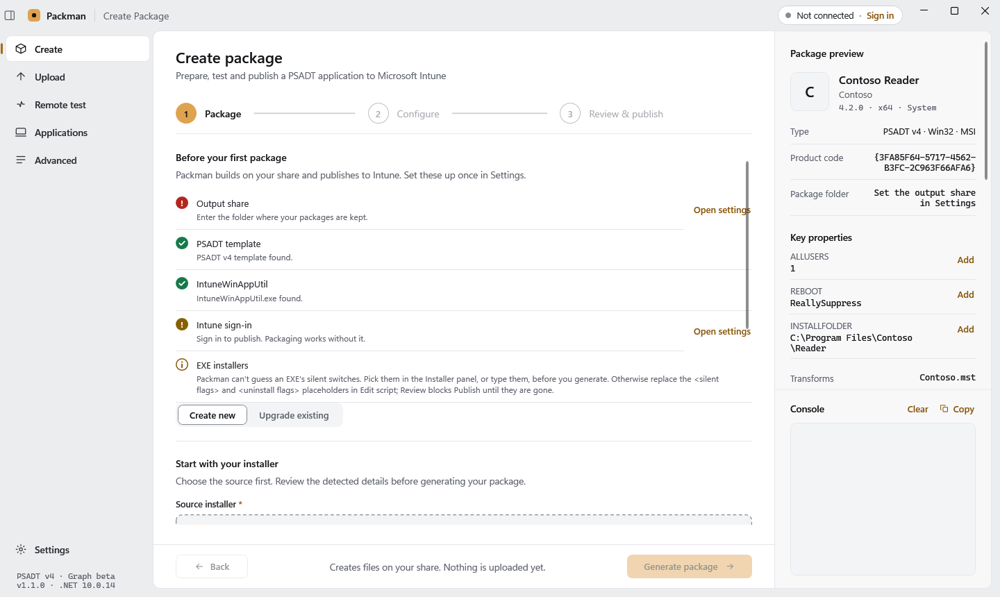
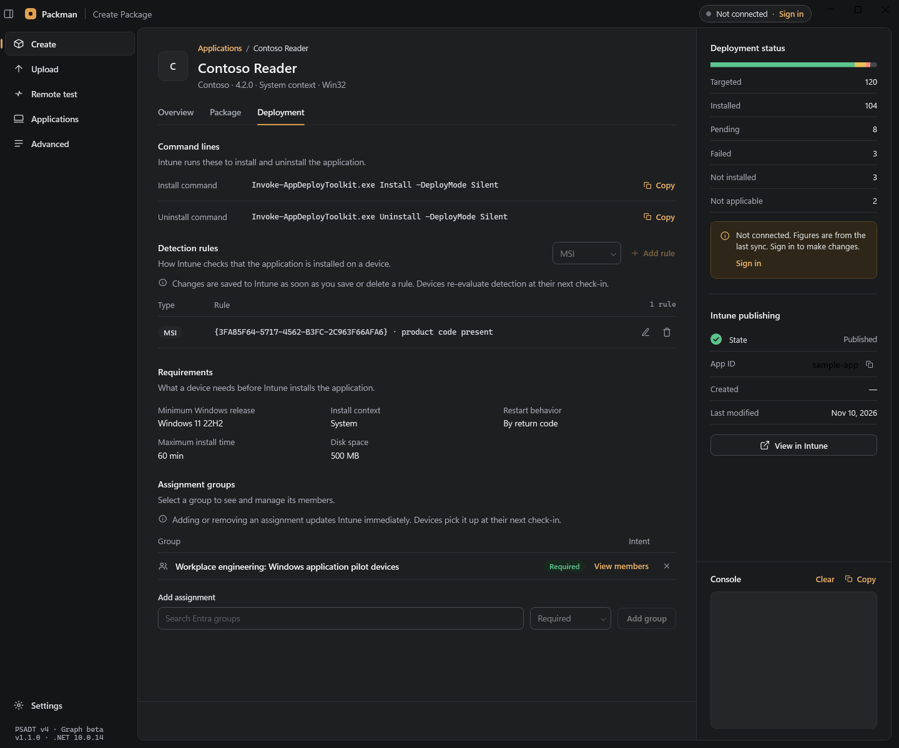

# Packman manual

The complete guide to setting up Packman, packaging an installer, testing the package on a real
machine and publishing it to Microsoft Intune. For the shortest path, start with the
[quick start](../HOWTO.md).

Screenshots in this manual are native Windows renders with sample data (Contoso Reader, TEST-PC-01);
they do not show a live tenant or a real deployment.

## Contents

- [Before you start](#before-you-start)
- [First-run setup — the Settings page](#first-run-setup--the-settings-page)
  - [Authentication](#authentication)
  - [Dedicated app registration](#dedicated-app-registration)
- [Creating a package](#creating-a-package)
- [Editing the deploy script](#editing-the-deploy-script)
- [Remote testing](#remote-testing)
- [Publishing to Intune](#publishing-to-intune)
- [Upgrading a package to a new version](#upgrading-a-package-to-a-new-version)
- [Upload to Intune (standalone)](#upload-to-intune-standalone)
- [Applications — browsing your tenant](#applications--browsing-your-tenant)
- [Advanced — directory tools](#advanced--directory-tools)
- [Where things live on disk](#where-things-live-on-disk)
- [What Packman cannot do](#what-packman-cannot-do)
- [Troubleshooting](#troubleshooting)
- [License and security reporting](#license-and-security-reporting)

## Before you start

Packman needs Windows, the .NET 10 Desktop Runtime, a PSADT v4 template folder that includes the
runtime, `IntuneWinAppUtil.exe` and, for publishing, a Microsoft Intune tenant with the Graph
permissions described under [Authentication](#authentication). The full list is in
[Requirements](../README.md#requirements). To build and run from source, or to get a CI build, see
[Get started](../README.md#get-started); [HOWTO.md](../HOWTO.md) walks through the first package.

---

## First-run setup — the Settings page

On first launch, before the three paths are set, Packman opens a short setup instead of the main
window: **Welcome**, **Connection**, **Paths**, **Package folders** and **Review and finish**.
**Get started** begins it, **Back** keeps what you typed, and nothing is saved until **Finish**.

- **Connection** — choose **Interactive sign-in** or **App registration** (**Tenant ID**,
  **Application (Client) ID** and a **Certificate** from `CurrentUser\My` that has a private key;
  the required Graph permissions are listed with a **Copy** button). **Test connection** must pass
  before **Next**, or choose **Connect later**: packaging works offline, and the Intune pages ask
  you to sign in until you connect in Settings.
- **Paths** — the **Applications share root** must exist (a write test creates and deletes a temp
  file; a read-only root only warns that `packman.id` cannot be written), the **PSADT v4 template**
  must hold `Invoke-AppDeployToolkit.ps1` and the `PSAppDeployToolkit` folder, and
  **IntuneWinAppUtil.exe** must be that file. The **PSADT releases** and **Microsoft download** links open the
  [PSADT releases](https://github.com/PSAppDeployToolkit/PSAppDeployToolkit/releases) and the
  [Win32 Content Prep Tool](https://github.com/microsoft/Microsoft-Win32-Content-Prep-Tool) pages;
  Packman downloads nothing.
- **Package folders** — see [Package layout](#package-layout).

Until you dismiss it, the **Create** page opens with a **Before your first package** card that
checks the output share, PSADT template, `IntuneWinAppUtil.exe` and Intune sign-in, each with an
**Open settings** link, and explains the EXE switches step. **Got it** hides the card for good
(saved in settings); it comes back while the share, template or converter is missing or broken.

**Run setup again** in Settings reopens it with your current values. The sections below describe
the same options on the Settings page. **Authentication** and **Network paths** are the two you
must complete; the rest have working defaults. Press **Save settings** when done — except
Appearance, which applies and saves immediately.

### Authentication

Two modes:

- **Interactive sign-in** (default) — press **Sign in** and complete the Microsoft prompt. With no
  **Application (Client) ID**, Packman uses the public *Microsoft Graph Command Line Tools* client,
  which exists in virtually every tenant, so no setup is needed. That client is shared with every
  Graph script in the tenant, so Settings recommends a dedicated registration while it is in use
  (see [Dedicated app registration](#dedicated-app-registration)). Set a **Tenant ID** to pin
  sign-in to one tenant, or leave it blank for `organizations`.
- **App registration** — enter **Tenant ID** and **Application (Client) ID**, then under
  **Certificate** choose **Select from store** or **Enter thumbprint** (the `CurrentUser\My` store
  or a pasted thumbprint). The registration needs application permissions and admin consent as
  listed below.

Graph permissions for the available features:

- *Interactive sign-in (delegated)*, requested when first needed rather than at sign-in:
  - Sign-in asks for read access only: `User.Read` and `DeviceManagementApps.Read.All`
    (browsing apps).
  - Publishing, and changing an app on its detail page (republish, detection rules,
    assignments), asks for `DeviceManagementApps.ReadWrite.All` the first time. **Test connection**
    asks for it too, because it verifies publishing.
  - **Advanced** asks for `Group.ReadWrite.All`, `GroupMember.ReadWrite.All`, `Device.Read.All`
    and `User.ReadBasic.All` when opened. Group and device access is asked for nowhere else:
    group search on the Upload step and app pages, the group members panel and the
    **Create an install group for each package** option point you to Advanced until it has
    been granted.

  Each request is a normal consent prompt; nothing prompts again once granted. Declining it cancels
  that action only, and nothing is sent. A tenant that already consented to the full set for the
  shared client keeps that consent; to narrow it, remove the grant under *Enterprise applications ▸ Microsoft Graph Command Line Tools ▸
  Permissions*, or move to a dedicated registration.
- *App registration (application):* `DeviceManagementApps.ReadWrite.All`,
  `Group.ReadWrite.All`, `User.ReadBasic.All`, and `GroupMember.ReadWrite.All`.
  Use `Device.ReadWrite.All` to add devices to groups; `Device.Read.All` suffices for device
  lookup if device membership changes are not used. `User.Read` is a delegated permission.

Group changes in interactive mode also require a supported Entra role or group ownership;
Intune operations remain subject to tenant permissions. Microsoft's
[add-member contract](https://learn.microsoft.com/en-us/graph/api/group-post-members?view=graph-rest-beta)
lists the different delegated and application permissions and supported roles.

**Test connection** reads apps, groups, devices and users and reports each read check separately.
The device and user checks run only once the sign-in holds `Device.Read.All` and
`User.ReadBasic.All`; before that they read *Requested when Advanced opens*.

It then checks write permission without writing anything. Packman reads the permissions listed in
the access token (`scp` for a signed-in user, `roles` for an app registration) and requires
`DeviceManagementApps.ReadWrite.All` for publishing, plus `Group.ReadWrite.All` (or `Group.Create`)
when **Create an install group for each package** or **Create an uninstall group for each package**
is on. The summary reads *Read and write verified*, *Read only: publishing will fail*,
*Group creation not permitted* or *Read checks failed*. A signed-in user's Entra role can still
narrow what a granted permission allows, so a pass means the token carries the permissions, not
that every change will succeed.

#### Dedicated app registration

For interactive sign-in through your own registration instead of the shared client:

1. In *Entra admin center ▸ App registrations ▸ New registration*, name it (e.g. *Packman*),
   choose *Accounts in this organizational directory only* and register.
2. Under *Authentication ▸ Add a platform ▸ Mobile and desktop applications*, add
   `https://login.microsoftonline.com/common/oauth2/nativeclient` and the broker redirect URI
   `ms-appx-web://microsoft.aad.brokerplugin/<application-client-id>`. Set
   *Allow public client flows* to *Yes*.
3. Under *API permissions ▸ Microsoft Graph ▸ Delegated*, add the scopes listed above. Granting
   admin consent is optional: without it each user consents when a feature first needs a scope.
4. In Packman, open **Settings**, choose **Authentication** and **Interactive sign-in**, enter the
   **Application (Client) ID** and the **Tenant ID**, then press **Sign in**.

Assign it to the packaging team under *Enterprise applications ▸ Packman ▸ Properties ▸
Assignment required* to limit who can sign in. The connection pill in the title bar turns green and
reads *Connected* with your tenant name once signed in; hover it for *Connected to Microsoft
Intune · you@tenant*.

### Code signing (optional)

Switch code signing to **Enabled** to Authenticode-sign the package files before the `.intunewin`
is built. Pick the signing certificate from the store with **Select from store** (or use
**Enter manually**) and set a **Timestamp Server** (defaults to DigiCert). Signing runs in-process —
no temporary PFX is written. If signing is enabled and the certificate or signing operation fails,
publishing stops before building or uploading content.

### Network paths

| Setting | What it is |
|---|---|
| **Intune Applications Path** | Root folder where packages are written, typically a share. |
| **PSADT Template Path** | Your PSADT v4 folder — either the folder containing `Invoke-AppDeployToolkit.ps1` or the script path itself. |
| **IntuneWinAppUtil Path** | Full path to `IntuneWinAppUtil.exe`. |

Package generation is blocked until the first two are set; upload is blocked until the third is.

### Package layout

Every new package gets `Application` (the PSADT files and installer; only this folder is packed
into the `.intunewin`) and `Intune` (the built `.intunewin` and `packman.id`). Two things are up to you:

- **Icon** (on by default) — keep the app icon in `Icon`. Off: the icon is extracted for the
  upload and not kept.
- **Extra folders** — plain folder names (not `Application`, `Intune` or `Icon`; no `\` or `/`;
  no reserved Windows names) created empty in every new package. They are not packed into the
  `.intunewin`, and a new version made with Upgrade copies their contents forward.

The setting applies to new packages only; existing packages are never changed. It is in
Settings ▸ Package layout and, during first-run setup, on the **Package folders** step.

### Group assignment

Defaults applied to every upload started from the **Create** wizard:

- **Create an install group for each package** — auto-create (or reuse) an Entra security group
  named from a template, with a chosen intent (Available / Required). Tokens: `%vendor%`,
  `%appName%`, `%appVersion%`. A live preview shows how the name resolves.
- **Create an uninstall group for each package** — same, always assigned with the *Uninstall* intent.
- **Always assign these existing groups** — a list of group names, each with its own intent. These
  pre-fill the assignment picker on the wizard's Configure step, where you can still edit them per
  package.

### Intune defaults

- **Install command** and **Uninstall command** (default `Invoke-AppDeployToolkit.exe Install` /
  `Uninstall`).
- **Device restart behavior** — the Intune `deviceRestartBehavior`: *based on return codes*, *app
  install may force a device restart* (the admin center default), *no specific action*, or *force*.
  PSADT packages usually map `3010` / `1641` to a soft reboot, so *based on return codes* lets the
  installer decide.
- **Maximum install time (minutes)** (`maxRunTimeInMinutes`, 1–1440, default 60).
- **App title template** for the app title in Intune — same `%vendor%` / `%appName%` /
  `%appVersion%` tokens, with a preview.
- **Device requirements**: minimum operating system, free disk space, memory, processors, CPU speed.
- **Return codes**: the Intune success/retry/failure mapping, with **Restore standard codes**.
- **Privacy URL** and **Information URL** for Company Portal (sent only when set).

### Appearance

Dark (default), Light, or System (follows the Windows app theme). Applied and saved on change.

Only implemented settings are shown. Appearance saves immediately; other changes use **Save settings**. Save and error feedback stays below the settings content.

---

## Creating a package

**Create** in the sidebar opens the **Create package** page, a three-step wizard — **Package**,
**Configure** and **Review & publish** — with two optional side trips (**Edit script** and
**Remote test**) available once the package exists. `↵` triggers the primary button; **Back**
steps back.



### Step 1 — Package

1. Leave the mode toggle on **Create new**.

   **Generate package** stays disabled until the installer, application name, manufacturer and
   version are filled in and the output share and PSADT template are set in Settings; its tooltip
   names the first thing missing.

2. Pick the source installer. Press **Browse…**, or drag an MSI/EXE straight onto the
   **Source installer** field. What happens next depends on the file type:

   | You select | Packman reads | Fields it fills |
   |---|---|---|
   | `.msi` | The MSI property table (`ProductName`, `Manufacturer`, `ProductVersion`, `ProductCode`, `UpgradeCode`) | Application name, Manufacturer, Version — and it remembers the product code, which later becomes the default detection rule |
   | `.exe` | The file's version resource (product name, company, file version) | Application name, Manufacturer, Version — whatever the resource actually contains |
   | Either | The embedded application icon | The icon shown on the card, archived into the package and uploaded to Intune with the app |

   Picking another installer replaces the name, manufacturer and version the previous one filled in;
   anything you typed into those fields yourself is kept.

   While the file is read the right rail shows **Reading installer…**; a file that cannot be read
   shows a warning there instead. Nothing is ever run: the read is static.

   The installer panel at the bottom of the right rail depends on the file type:

   - EXE — Packman looks at the PE headers, sections, resources and the data appended to the
     file and names the technology (Inno Setup, NSIS, WiX Burn, InstallShield, Advanced Installer,
     InstallAware, Wise, Setup Factory, Squirrel/Velopack, ClickOnce, 7-Zip/WinRAR SFX, MSIX/AppX
     bundle) with a High, Medium or Low confidence and the marker it matched. The known
     **Install switches** and **Uninstall switches** are listed with a one-line explanation; **Add** puts a
     switch into the **Install arguments** or **Uninstall arguments** field. If nothing matches, the
     type is *Unknown* and the common guesses are listed, each marked *untested*. The table
     lives in `Packman/Services/InstallerCatalog.cs`; a new installer type is a new entry there.
   - MSI — the key **MSI properties** (`ProductName`, `ProductVersion`, `Manufacturer`,
     `ProductCode`, `UpgradeCode`, `ALLUSERS`, the reboot properties and the install directories),
     then **All properties** with a **Search MSI properties** box. Public (uppercase) properties
     have an **Add** button that puts `NAME=value` into **Install arguments**. `.mst` transforms
     beside the MSI are listed; Packman copies only the MSI, so add the `.mst` to Files and use
     `-Transforms` in Edit script.

   If the EXE has no usable metadata, the app name falls back to a cleaned-up version of the file
   name. Only **empty** fields are filled — anything you already typed is left alone, so you can
   type the name first and drop the file second.

3. Fix up the details yourself. **Manufacturer**, **Application name**, **Version** and
   **Architecture** (**x64** / **x86**) are all plain editable fields. Nothing here is locked:
   installer metadata is often wrong or ugly ("Acme Reader (x64) 24.1 MUI"), and what you type is
   what ends up in the script, in the folder name and — through the app title template — in the app
   title in Intune.

4. Pick the **Install context**. This is written into the script as `RequireAdmin`:

   - **System** — installs for all users, elevated. The usual choice for managed apps.
   - **User** — installs for the current user only, without elevation.

5. **Install arguments** and **Uninstall arguments**. Two optional fields in the
   **Command arguments** section, filled by the rail's **Add** buttons (or typed). They are written into the
   generated script: an EXE's `-ArgumentList` and, for an MSI, `-AdditionalArgumentList`. Leave
   them empty and the EXE keeps the `<silent flags>` / `<uninstall flags>` placeholders. The
   uninstall line still runs the setup file; where the vendor's real uninstaller is a separate file
   the rail says so.

6. Press **Generate package**.

What generation does: Packman copies your PSADT template into

```text
<Intune Applications Path>\<Vendor>_<AppName>\<Version>\
    Application\      <- the PSADT template; your installer lands in Application\Files\
    Intune\           <- the .intunewin is built here at upload time, plus packman.id linking it to its Intune app
    Icon\             <- the icon extracted from the installer
```

then rewrites `Invoke-AppDeployToolkit.ps1` — `AppVendor`, `AppName`, `AppVersion`, `AppArch`,
`AppScriptDate`, `AppScriptAuthor`, `RequireAdmin` — and injects the deployment calls:

- MSI → `Start-ADTMsiProcess -Action 'Install' -FilePath "$($adtSession.DirFiles)\your.msi"`,
  and an uninstall by product code. Usually ready to run as generated.
- EXE → `Start-ADTProcess -FilePath "$($adtSession.DirFiles)\setup.exe" -ArgumentList
  '<silent flags>'`, and the same for uninstall with `'<uninstall flags>'`. Unless you filled
  **Install arguments** and **Uninstall arguments**, you must replace those two placeholders in
  the editor — they are literal text, not real switches.

If that version folder already exists you are asked whether to replace it (**Replace package**);
declining cancels without touching anything.

Once a package exists, the **Optional before publishing** card offers three actions —
**Edit script**, **Remote test** and **Open folder** — and the primary button becomes
**Continue to configure**. **Start a new package** resets the form.

---

## Editing the deploy script

**Edit script** opens the package in the built-in editor. It is optional — but for an EXE package
it is where you replace `<silent flags>` and `<uninstall flags>` with the installer's real switches
(unless you added them in step 1), point the uninstall line at a separate uninstaller, or add
`-Transforms` for an MSI.

- The left rail lists **Package files**; the **Search names and contents…** box searches file
  names and contents and jumps to the matching line.
- Open files become tabs. A dot on a tab means unsaved changes. **Save** (or Ctrl+S) writes to the
  package on the share, preserving the file's original encoding and line endings.
- PowerShell files get PSADT v4 completions, hover documentation and signature help from the
  bundled catalog (type `Show-ADT…` or `-ADT`; `-` after a function name lists its parameters), a
  **Functions** button (Ctrl+Shift+I) that opens a searchable picker grouped by verb and inserts the
  call at the cursor, and functions that the package's PSADT version lacks are hidden from
  completion and marked in the picker. They also get live syntax checking — the problem count
  sits in the status bar and errors are underlined. The check only parses; it never runs the script.
- If a file changes on disk while it is open, a **Changed on disk: reload** button appears.
  **Reload** re-reads the file; **Revert** throws away your buffer and re-reads the file.
- **Open externally** (toolbar) opens the active file — or the deploy script — in VS Code,
  PowerShell ISE, or the system default, in that order of preference.
- **Back to package** returns to the wizard; **Continue to configure** goes straight on. The
  toolbar also offers **Remote test** and **Open folder**.

If the WebView2 Runtime is missing the editor is replaced by a note that points to **Open externally**.

---

## Remote testing

**Remote test** stages the package on a machine and runs it there, so you see the real install
before Intune ever sees the package. It is optional.

WinRM is only the transport — the install itself runs from a one-shot **scheduled task**, because a
remote session runs as the connecting admin and would not match Intune's identity. The task runs
the install or uninstall command line from Settings ▸ Intune defaults (by default
`Invoke-AppDeployToolkit.exe Install`) from the staged `Application` folder, exactly as the Intune
Management Extension does, so the launcher, PowerShell edition and module isolation match production.

1. **Package** — pre-filled with the package the wizard just generated. On the standalone
   **Remote test** page (sidebar) there is no wizard package, so press **Browse…** and pick one
   built earlier; name and version are read back out of its script.
2. **Computer** — type a name or pick a recent one, then press the ping icon (tooltip *Check the
   computer is online (ping)*) to check reachability. The status reads *online* or *unreachable*.
3. **Context**:
   - **System** (default) — runs as `NT AUTHORITY\SYSTEM`, the identity the Intune Management
     Extension uses for a System-context deployment. SYSTEM has a different `%TEMP%` and
     HKCU, and reaches network shares as the *machine* account, so a package that works under your
     own login can still fail here.
   - **User** — runs in the logged-on user's session, so their profile and HKCU apply and the PSADT
     dialogs can be visible when the deployment mode permits interaction. Somebody must be logged on.

   Choose the context that matches the app’s configured Intune install behavior.
4. **Deploy mode** — Auto / Interactive / NonInteractive / Silent, appended to the command
   line as `-DeployMode` the same way the Configure step does it. Pick the mode you intend to
   publish with; the resulting install and uninstall commands are previewed underneath.
5. Optionally tick **Delete the staged package from the target after the run** (off by default, so
   a re-run only copies what changed). The setting is remembered.
6. **Install** first checks the package as Review does and lists anything wrong as a warning
   (a leftover EXE placeholder, say); the run still goes ahead. It then makes sure
   `C:\ProgramData\Packman` on the target is owned by Administrators, with inheritance off and
   access for SYSTEM and Administrators only. A folder there that anyone else could change is
   renamed to `Packman.untrusted-<timestamp>` and a fresh one is created; if the folder still
   can't be secured, the run stops before anything is copied. It then copies the package there over
   the admin share (a **User** run also gives that user read access to this package's
   folder and write access to its console log, nothing more), registers the
   task with the install command line, and streams the PSADT log into the **Output** console as the
   toolkit writes it — the launcher itself prints nothing, so the log is the live view. Warnings and
   errors are colour-coded from the log entry's own severity. **Uninstall** does the same with the
   uninstall command line. The log folder comes from the package's `Config\config.psd1`
   (`Toolkit.LogPath`, falling back to `LogPathNoAdminRights` and the toolkit defaults); with
   `CompressLogs` enabled PSADT writes to a temp folder and zips at the end, so nothing streams.
7. After a successful install Packman waits for the registry to settle and searches the target for
   the executable that was installed, proposing a detection rule from its real path and
   version. **Discover detection** re-runs that search on its own.
8. **Use this rule for publishing** pushes that rule into the wizard's Configure step. This is only
   available for the wizard's own package — a package picked from the share has no publish step to feed.

**Cancel** stops the copy (robocopy and its workers are ended) or the deployment; a cancelled
deployment also stops and removes the scheduled task on the target.

Exit codes `0`, `3010` and `1641` count as success (the latter two mean *reboot required*).

---

## Publishing to Intune

### Step 2 — Configure

Nothing is sent to Intune from this step. It is where you decide how the app will land, and
every field here is pre-filled from Settings and then editable for this one package.

1. **Name in Intune** — built from the **App title template** in Settings
   (`%vendor% %appName% %appVersion%` by default). This is the title users and admins see; edit it
   freely, it does not change the folder or the script.

2. **Detection method** — how Intune decides the app is installed. One rule, one of four kinds:

   | Method | You supply | Pre-filled when |
   |---|---|---|
   | **MSI product code** | product code | the package contains an MSI — Packman reads the code off it and selects this method automatically |
   | **File exists** | path + file or folder name | — |
   | **File version** | path + file name + version to compare (`>=`) | non-MSI packages: the version is pre-filled from the package, the path is yours to supply |
   | **Registry key exists** | hive + key path + optional value name | — |

   If you ran a remote test, **Use this rule for publishing** will have filled a file/version rule in from the
   real install. Packman refuses to upload an incomplete rule — Intune would accept it and then
   never detect the app, so a Required assignment would reinstall forever.

3. **PSADT deploy mode** — how `Invoke-AppDeployToolkit.exe` runs on the device:

   | Mode | Behaviour |
   |---|---|
   | **Auto** (default) | PSADT chooses from session state and toolkit configuration; behavior depends on the PSADT version. |
   | **Interactive** | For attended testing; do not rely on user interaction during an Intune installation. |
   | **NonInteractive** | Does not wait for user input; progress may be shown when a suitable user session exists. |
   | **Silent** | No dialogs at all. |

   Anything other than *Auto* appends `-DeployMode <mode>` to **both** command lines; the result is
   previewed under the picker. A command that already sets `-DeployMode` in Settings is used as
   written.

4. **Requirements** and **Return codes** — minimum Windows release, disk, memory, processors, CPU
   speed, and the success/retry/failure return-code map. Pre-filled from Settings ▸ Intune defaults,
   editable per package, with **Restore defaults**.

5. **Assignments** — who gets the app. Pre-filled with the groups from
   Settings ▸ Group assignment (each resolved against Entra when the step opens). To change it:
   pick an intent — **Required** (installs it), **Available** (offers it in Company Portal) or
   **Uninstall** (removes it) — type at least part of a group name, and click a result to add it as
   a chip. Each row keeps its own intent, so one package can push to a pilot group as Required,
   offer itself to a wider group as Available, and remove itself from a third, all in one upload.
   Remove any row you do not want for this package. A default group that no longer exists in Entra
   is shown but skipped, with a note saying so.
6. **Supersedence** (optional) — search the connected tenant's Win32 apps in the **Supersedes**
   box and choose the ones this app supersedes, each as **Update** or **Replace**. Nothing is
   superseded unless you add it; the relationships are written in one call after upload.

### Step 3 — Review & publish

Everything you chose, read-only, in one place: destination tenant, package metadata, source size, deploy mode, command lines, detection, requirements, return codes and assignments. Per-package groups that will be created or reused are listed separately. **Edit package**, **Edit configuration** and **Run remote test** return directly to the relevant task. Check it, confirm you are signed in
and that the IntuneWinAppUtil path is set, then press **Publish to Intune**.

Packman checks the staged `Application/` folder for the PSADT script, launcher and module manifest whenever you enter Configure or Review, and again when you close Edit script there. It parses the script without executing it and flags syntax errors and the generated EXE `<silent flags>` / `<uninstall flags>` placeholders. The rail's **Package** row reads *Checking…*, *Ready* or *Needs attention* with the first issue, Review lists every issue, and **Publish to Intune** stays disabled until the package is clean. The same check runs again before signing or building. This is a preflight check, not proof that the installer works: test both installation and removal on a representative device.

Use **Silent** for unattended Intune deployment. Microsoft's Win32 guidance requires installation without user interaction. PSADT Auto behavior also depends on toolkit version and configuration; see [Microsoft's Win32 app guidance](https://learn.microsoft.com/en-us/intune/app-management/deployment/add-win32) and [PSADT deployment modes](https://psappdeploytoolkit.com/docs/explanation/deployment-modes).

Upload does the following, with a shared five-stage progress panel:

1. *Signing with Authenticode*: signs the deploy script, if code signing is enabled in Settings.
2. *Building .intunewin package*: builds the `.intunewin` into the package's `Intune` folder using
   `IntuneWinAppUtil.exe`.
3. *Registering Win32 app*: registers the app in your tenant with your detection rule,
   install/uninstall command lines, requirements, return codes, install context, icon, and the
   privacy/information URLs.
4. *Uploading to your tenant*: uploads the encrypted content to Azure blob storage, streamed
   straight out of the `.intunewin`, and commits it.
5. *Publishing and assigning*: publishes the app and assigns the groups listed on the Review
   step — and, if those options are on in Settings, creates (or reuses) the per-package install
   group and uninstall group from their name templates and assigns those too.

Before publication, cancelling attempts to remove a known half-created app; the result line
reports cleanup success or failure. If no app ID was confirmed, check Intune before retrying.

On success the status reads *Uploaded to Intune · App ID …*, `Intune\packman.id` (app ID, tenant
ID, upload time, display name and version, `.intunewin` file name and size) is written into the
package folder, and — if you chose apps in **Supersedence** on Configure — their
**supersedence** relationships are written, each as **Update** or **Replace**, in one call.

Packman waits for Intune to report the app as published before assigning groups. If final
publication is uncertain, or later assignment or supersedence work fails or is cancelled,
Packman retains the app and shows its ID with a warning. Review its content, publishing state
and assignments in Intune before creating another copy; a lost response does not prove that
the change failed.

---

## Upgrading a package to a new version

From **Create Package**, switch the mode toggle to **Upgrade existing**:

1. Press **Browse…** next to **Existing package folder** and pick the existing package folder.
   Packman reads its vendor, name, version and install context back out of the script.
2. Select the **New source file** (the new MSI or EXE); **New version** is auto-filled from its
   metadata (edit it if you disagree).
3. Press **Upgrade package**.

The old package is copied forward — keeping your script edits and everything under `Files\`
(transforms, config and licence files stay put) — only the installer the script points at is
replaced by the new one, the script metadata and MSI product code are refreshed, and the icon is
carried over. If the script names no installer, the old one is left next to the new one and the
status line says so. The wizard then continues exactly as for a new package. Nothing is superseded
automatically: if the old package was published from Packman, Configure offers a one-click
**Supersede the previous version** suggestion (identified by `Intune\packman.id` in the old package folder).

Unlike Create, an upgrade **fails** rather than prompting if the target version folder already
exists — delete it or pick a different version.

---

## Upload to Intune (standalone)

**Upload** in the sidebar opens the **Upload to Intune** page, which publishes a package that
already exists on disk, without going through the wizard:

1. Press **Browse…** under **Package folder** and select the package folder (the one containing
   `Application\`). Packman checks for `Invoke-AppDeployToolkit.exe` and the deploy script, then
   reads the metadata and install context back out of the script.
2. Edit the **Name in Intune** if needed.
3. Review the **Detection rules** — a product-code rule is proposed from a staged MSI. Unlike the
   wizard you can add several rules here with **Add rule** (File, Registry or MSI); Intune requires
   all of them to match, and the upload refuses to start with none.
4. Under **Assignments**, search and add Entra groups, each with an intent.
5. Press **Publish to Intune**. The same five-stage overlay as the wizard tracks the publish and
   can be cancelled.

The page takes the install/uninstall command lines, requirements and return codes from Settings ▸
Intune defaults as starting values; the **PSADT deploy mode** picker and **Restore defaults** work as
in Configure. This page does not upload the package icon and has no **Supersedes** field: use the
wizard for either.

---

## Applications — browsing your tenant

**Applications** lists the Win32 LOB apps in your tenant. It requires being signed in; if you
are not, the page offers a link to Settings instead. The list is fetched once and cached for the
session — **Refresh** forces a re-fetch, and it reports progress while paging through Graph.

### Navigating the list

- **Search applications** matches the display name and publisher.
- **Category**, **Publisher** and **Updated** (Any time / Last 7 / 30 / 90 days) filters. The
  category and publisher lists are built from the apps actually returned.
- Click the **Application** or **Updated** column header to sort; click again to flip direction.
  The default is newest-updated first.
- 50 apps per page, with previous/next and a "showing X–Y of Z" readout. Changing any filter
  resets you to page 1.
- A row whose publishing state is not *published* carries a pill — *Processing…* or *Upload
  incomplete*.
- A single click selects a row and fills the right rail; double-click it, or press Enter, to open its
  detail (**Open details** in the rail does the same). The **Applications** breadcrumb takes you back.

### Application detail

The header carries **Republish content** and **Edit script** when the package folder's `Intune\packman.id`
links it to this app in the connected tenant; otherwise they are hidden. The right rail shows
**Deployment status** and **Intune publishing**, with **View in Intune** and the App ID with a copy
action; **Delete from Intune** sits in the **Danger zone** at the end of Overview. Three tabs:

**Overview** — publisher, version, category, package type, size, dates, publishing state,
description, and the current assignments (read-only here; *Manage in Deployment* jumps to the tab
that edits them).

**Package** — where the app lives on your share. Packman searches the `<Vendor>_<AppName>\<Version>`
folders under the Intune Applications path for the one whose `Intune\packman.id` links it to this app
and runs an integrity check:

| Check | Meaning |
|---|---|
| `Invoke-AppDeployToolkit.ps1` | deploy script present |
| `*.intunewin` | present, and its size compared against what Intune reports (10% tolerance for encryption overhead) |
| `detection.xml` | detection definition present |
| `Icon\…` | icon archived with the package |

From here you can **Copy** the path or **Open folder**; **Edit script** in the header opens it in VS Code / ISE.

**Deployment** — the **Command lines** (with **Copy** buttons), editable **Detection rules**,
**Requirements** and **Assignment groups**. The detection editor supports:

- **Add rule** — MSI, File or Registry.
- Inline edit of path, file/folder or value name, detection type (exists, does not exist, version,
  string, integer, size in MB, modified date), operator and value, then **Save rule**.
- Delete a rule, with a warning that removing the last matching rule makes Intune think the app is
  not installed and reinstall it on Required assignments.
- Saving PATCHes the whole rule array back to Intune; devices re-evaluate at their next check-in.
- PowerShell script detection rules are shown but cannot be edited in Packman.

Requirements show install context, restart behavior, maximum install time and disk space.
The right rail shows the deployment rollup: targeted devices with an installed / pending / failed
bar plus not-installed and not-applicable counts. The Overview's **Devices** section lists every
device that reported, with the report's own status detail and the error code in hex and decimal;
codes Microsoft documents (Windows Installer, Win32, Intune) also get their published meaning.
**Export CSV** saves the rows on show as UTF-8 CSV, with formula-like values prefixed by `'` so
Excel treats them as text. The report needs `DeviceManagementApps.Read.All`, which the
`DeviceManagementApps.ReadWrite.All` permission above includes. Assignment actions include:

- **Add assignment**: pick Required / Available / Uninstall, search Entra groups, press **Add group**.
- Remove an assignment.
- Click a group, or **View members**, to open the members panel: the first 100 members, an
  **Add member** box that searches devices and users, and add/remove. Membership changes affect every
  app assigned to that group — the panel says so. Built-in targets (All Devices / All Users) have
  no member list.
- **Delete from Intune** (in the **Danger zone**) removes the app and its assignments from the
  tenant after a confirmation. It cannot be undone; devices keep their installed copy.



---

## Advanced — directory tools

Three lookups the Intune portal does not offer directly. All require being signed in. Opening the
screen asks for the directory scopes sign-in leaves out (`Group.ReadWrite.All`,
`GroupMember.ReadWrite.All`, `Device.Read.All`, `User.ReadBasic.All`); if you decline, the tools stay
hidden behind a **Grant access** button.

1. **Bulk add PCs to group** — pick a **Target group** (you must select it from the results, so the
   name is known to exist), paste PC names separated by newlines, commas, semicolons, tabs or
   spaces, and press **Add to group**. Each name gets a row: *Added*, *Already a member*, *Not
   found* or *Failed*, plus a summary line. Re-enrolled machines that left several Entra device
   records are all added, so the live one is covered.
2. **PC group membership** — search a device by name and list the groups it is a direct member of,
   marked Assigned or Dynamic.
3. **Apps assigned to group** — search a group and list every app that targets it, with the intent
   and whether the target is an exclusion. Graph has no reverse index for this, so Packman walks the
   app list with assignments expanded and reports progress while it does.

---

## Where things live on disk

| What | Where |
|---|---|
| Settings | `%LocalAppData%\Packman\appsettings.json` (a legacy copy next to the executable is read once and migrated) |
| Upload logs | `%LocalAppData%\Packman\Logs\Upload\<App>-<date>.log` |
| Update logs | `%LocalAppData%\Packman\Logs\Update\<App>-<date>.log` |
| Crash / error logs | `%LocalAppData%\Packman\Logs\Errors\error-<date>.log` |
| Editor cache | `%LocalAppData%\Packman\WebView2\` |
| Packages | `<Intune Applications Path>\<Vendor>_<AppName>\<Version>\` |
| `packman.id` link file | `<package>\Intune\`, next to the `.intunewin`; written on a successful upload or republish |
| Staged test copy | `C:\ProgramData\Packman\...` on the target machine (SYSTEM and Administrators only) |

---

## What Packman cannot do

Known limits, so you do not go looking:

### Scope

- Windows only. There is no macOS, Linux or web build.
- Win32 LOB apps only. The Applications list filters on `win32LobApp`; store apps, LOB MSI, web
  links and iOS/Android apps are not shown and cannot be created.
- Packages must be PSADT v4. Both the upgrade flow and the standalone upload refuse a folder
  without `Invoke-AppDeployToolkit.ps1` / `Invoke-AppDeployToolkit.exe`; PSADT v3 packages are not
  supported.
- You cannot upload a bare `.intunewin` or an arbitrary installer — the package must have the
  PSADT layout.
- Packman does not ship the PSADT runtime. The bundled template is script-only; without the
  runtime in your template folder the `.intunewin` build produces nothing, and a remote test
  refuses to start because `Invoke-AppDeployToolkit.exe` is missing.

### Editing published apps

- Apps uploaded outside Packman can't be updated from Packman yet. Linking existing Intune apps is planned.
- On a published app you can edit detection rules and assignments only. Display name,
  description, publisher, command lines, requirements, return codes, restart behavior, install time
  and the icon cannot be changed from Packman — publish a new version, or edit those in the Intune
  admin center.
- Restart behavior and maximum install time are tenant-wide defaults from Settings, not editable per
  package in the wizard. The architecture requirement follows the package's `AppArch`; there is no
  ARM64-only choice in the wizard.
- **Republish content** rebuilds the existing source folder and replaces the content served by the same Intune app. It preserves metadata, detection, commands and assignments, so review those separately when the installed application changes. For a new application version with supersedence, use **Create** and switch to **Upgrade existing**.
- PowerShell script detection rules can be viewed but not edited.
- **Delete from Intune** deletes the app in the tenant. There is no soft-retire, archive or undo. Use an Uninstall assignment to remove an installed app from devices.

### Assignments

- Assignments target security groups only. Packman does not create *All Devices* / *All Users*
  assignments, exclusion targets, or assignment filters — it can display an exclusion found
  on a group (**Apps assigned to group** in Advanced) but not create one.
- Per-package groups are assigned security groups. Packman does not create dynamic groups, and
  membership of a dynamic group cannot be edited by hand.
- Group display names must resolve unambiguously — a default group name from Settings that does
  not match exactly one Entra group is skipped, with a warning in the log.
- The group members panel shows the first 100 members only.
- Adding or removing members needs `GroupMember.ReadWrite.All`; without it the panel reports a
  permission error rather than failing silently.

### Wizard and testing

- The Remote test **Use this rule for publishing** button only works for the package the wizard
  generated. A package browsed from the share has no publish step to feed.
- The remote test runs **Install** and **Uninstall** only — there is no Repair button.
- Remote testing needs WinRM enabled on the target, firewall access, and administrative rights (the
  copy goes over `C$`). The **User** context additionally needs somebody logged on.
- Detection discovery searches for an installed executable. Packages that install no `.exe`, or
  whose executable name looks like an uninstaller/setup/helper, will not produce a rule — set one by
  hand.
- The wizard's Configure step takes one detection rule. Use the standalone **Upload to Intune** page
  when you need several.
- The standalone **Upload to Intune** page does not upload the package icon and cannot set
  supersedence; use the wizard for those.

### Performance and scale

- The Applications list is loaded in full and then filtered, sorted and paged client-side. A very
  large tenant means a longer first load.
- **Apps assigned to group** scans every app in the tenant. It reports progress, but it is slow by
  nature.
- Nothing is scheduled or automated: Packman has no CLI, no batch import, and no background sync.

---

## Troubleshooting

| Symptom | Fix |
|---|---|
| *Configure IntuneApplications and PSADTTemplate paths in Settings first.* | Set both under Settings ▸ Network paths. |
| *Set the IntuneWinAppUtil path on the Settings page first.* | Point **IntuneWinAppUtil Path** at `IntuneWinAppUtil.exe`. |
| *PSADT template not found.* | The template path must be the folder containing `Invoke-AppDeployToolkit.ps1` (or that script's path). |
| *IntuneWinAppUtil finished but produced no .intunewin file.* | The template needs the full PSADT v4 runtime, not just the script. See `Packman/PSADT/README.md`. |
| *Package version … already exists.* | Confirm the replace prompt (create), or delete the version folder / pick another version (upgrade). |
| *Sign in to Intune on the Settings page first.* | Sign in, then press **Test connection**, before uploading. |
| Connection test shows a failed read check | Review the HTTP status, consent and tenant access for that service. The write checks run separately. |
| Connection test reads *Read only: publishing will fail* | The sign-in lacks `DeviceManagementApps.ReadWrite.All`. Press **Test connection** again and accept the consent prompt, or grant the permission to the app registration with admin consent. |
| Connection test reads *Group creation not permitted* | Per-package groups are on but the token lacks `Group.ReadWrite.All` (or `Group.Create`). Open **Advanced** to grant it, or turn the group options off. |
| The connection test passes but a change is refused | The test reads the permissions in the token and cannot see Entra roles or group ownership. Check the signed-in user's role for the operation. |
| *Detection needs a path and a file name.* | The upload is blocked deliberately — Intune would accept an incomplete rule and then never detect the app. |
| The app installs but Intune keeps reinstalling it | The detection rule does not match reality. Remote-test the package and use **Discover detection**, or fix the rule on the app's Deployment tab. |
| An EXE package "succeeds" but installs nothing | The `<silent flags>` placeholder was never replaced. Open the script and put the installer's real silent switches in. |
| The in-app editor shows a plain note instead of code | The Edge WebView2 Runtime is missing. Install it, or use **Open externally**. |
| Remote test: *WinRM connection failed* | Run `Enable-PSRemoting -Force` on the target and allow WinRM through its firewall. |
| Remote test: the status reads *unreachable* | The target did not answer a ping — check the name and that it is powered on. Some networks block ICMP while WinRM still works; try the run anyway. |
| Remote test: *No user is logged on…* | A **User** context run needs somebody signed in to the target. Use **System**, or log on first. |
| Remote test: *No matching application files found* | Detection discovery could not find the installed executable — set the detection rule by hand on the Configure step. |
| Upload failed partway | Read the per-upload log under `%LocalAppData%\Packman\Logs\Upload\`; its path is printed at the start of the run. Packman tries to delete a known half-created app. If publication was confirmed or is uncertain it keeps the app and shows its ID, so check Intune before retrying. |
| Group not assigned after upload | The name did not resolve to an Entra group. The log names it under *GROUP ASSIGNMENT*. |
| Settings will not save | Packman writes to `%LocalAppData%\Packman\`; the page reports the actual error under the **Save settings** button. |

---

## License and security reporting

Packman is released under the [Apache License 2.0](../LICENSE). Bundled components keep their own
terms; see the [third-party notices](../THIRD-PARTY-NOTICES.md). Report vulnerabilities privately,
as described in [SECURITY.md](../SECURITY.md); do not post secrets, tokens or tenant details in public
issues.
